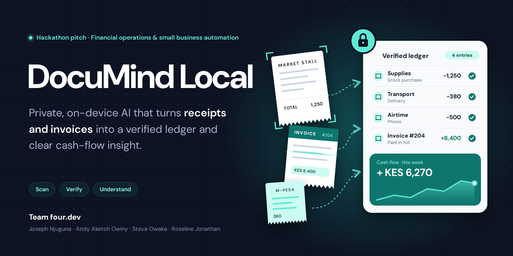
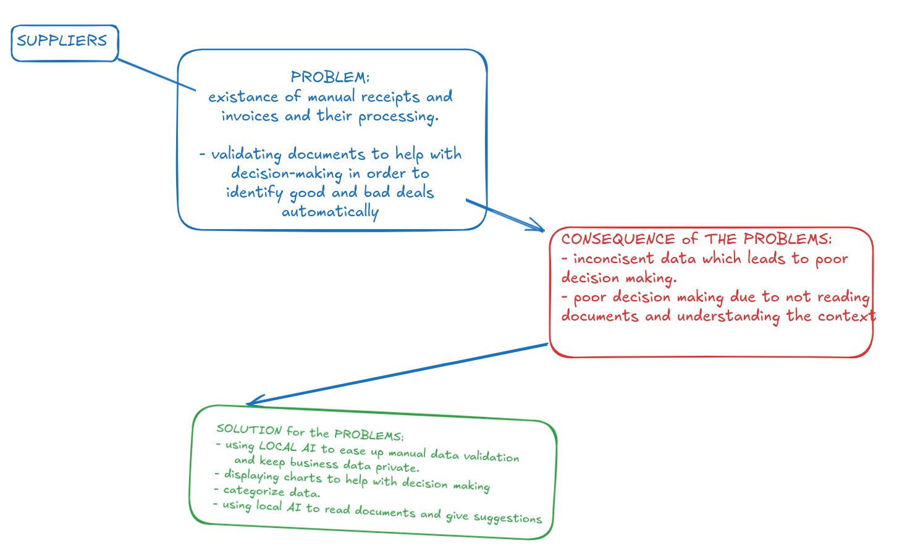
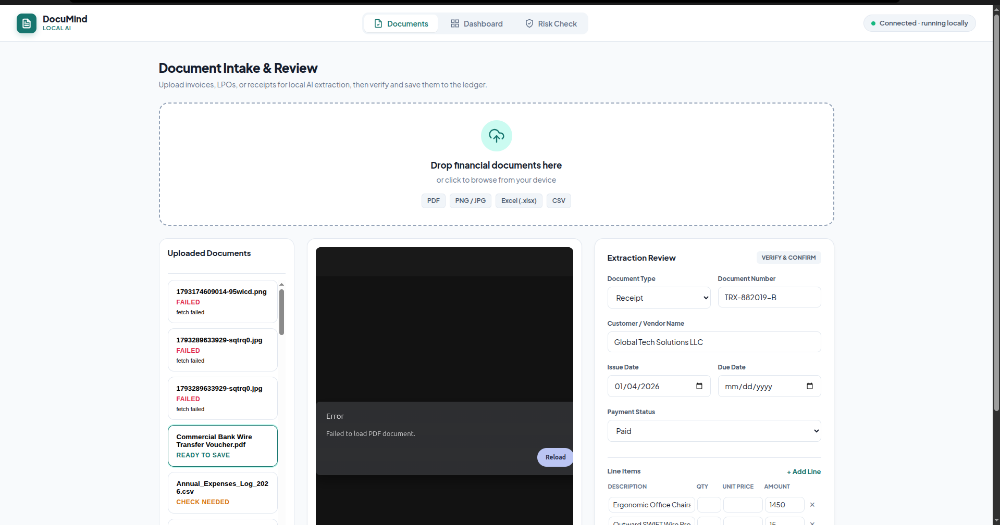
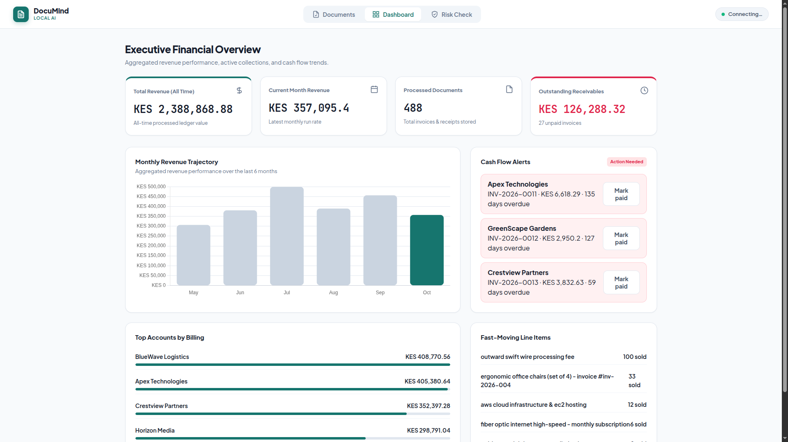
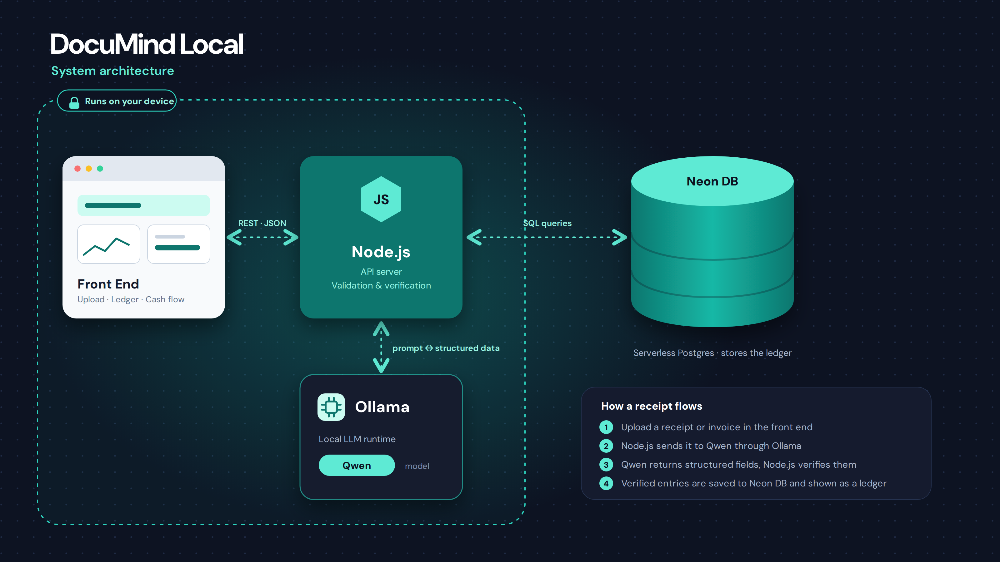

## Team Name:
four.dev

## Challenge Area:
Financial Inclusion / Trust & Misinformation Automation

## Live Demo Link
https://josephnjuguna.github.io/DocuMind/ui/index.html#documents

## Slides Pages
https://docs.google.com/presentation/d/1nEjx0E8J7K6lEM_rcohQGCW-KGNRShi3YFshlox5L9k/edit?usp=sharing

## 1. Project Overview

DocuMind Local is an offline-first application designed to help small businesses process receipts and invoices, reduce manual bookkeeping, and gain useful financial insights while maintaining the privacy of their business data.

The project uses local AI to assist with document data extraction and categorization, helping business owners save time and make informed financial decisions.

## 2. Problem Statement

Small business owners and local retailers often process receipts and invoices manually. This approach is time-consuming and can lead to inconsistent financial records, data-entry errors, and difficulties making informed business decisions.

DocuMind Local aims to address these challenges through automated document processing, AI-assisted data extraction, and financial analytics.

## 3. Key Features

DocuMind Local provides receipt and invoice uploads, AI-powered data extraction, validation of extracted information, document review and confirmation, invoice management, document processing status tracking, and a financial dashboard.

## Data Upload and Processing

Users can review and correct extracted information before confirming a document and saving it as an invoice. This keeps human review an important part of the process.


## Viewing Dashboard
a dashboard user can view all their data analysez and arranged in accordance to their importance


## Document Validation for mistrust and misinformation


## 4. Technology Stack
This project uses



#### FrontEnd 
---
- HTML, 
- CSS,
- JavaScript(DOM Manipulation)

### BackEnd
 - Node.js for backend services, 
 - Ollama for local AI processing, 
 - PostgreSQL (Neon) for database storage. 
 - Multer handles file uploads,
 - Sharp supports image processing.

 ### Data Storage
 - PostgreSQL

  ### Local AI Model Used
 - Qwen 3.5:4b parameter(2GB size on Disk)

## 5. Installation and Setup

### Prerequisites

Before running DocuMind Local, ensure you have Node.js, npm, Git, Ollama, and access to the configured PostgreSQL database.

### Setup Instructions

1. Clone the project repository:

   ```bash
   git clone <your-repository-url>
   ```

2. Navigate to the project directory:

   ```bash
   cd <project-folder>
   ```

3. Install the project dependencies:

   ```bash
   npm install
   ```

4. Configure the required environment variables for the database connection and backend settings.

5. Ensure Ollama is installed and the required model is available.

6. Start the application using the appropriate command configured in the project.

## 6. Usage

After starting the application, open it in your browser and upload a supported receipt or invoice. The system processes the document and extracts relevant information.

Review the extracted details, correct any errors or missing information, and confirm the document to save it as an invoice. You can then view confirmed invoices and explore the financial dashboard.

## 7. Contributors

DocuMind Local was developed by **four.dev**.

- **Roseline Jonathan:** Lead, Product Planner, Presenter, and Frontend/UI Designer.
- **Steve Owaka:** Lead, Product Planner, Presenter, and Frontend/UI Designer.
- **Joseph Njuguna:** User Research (Data Science) and Backend Developer.
- **Andy Aketch Owiny:** Backend Developer (Software Engineering).
